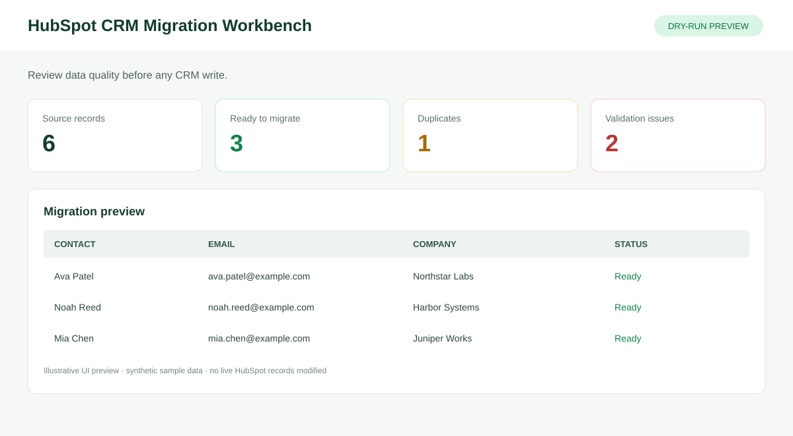
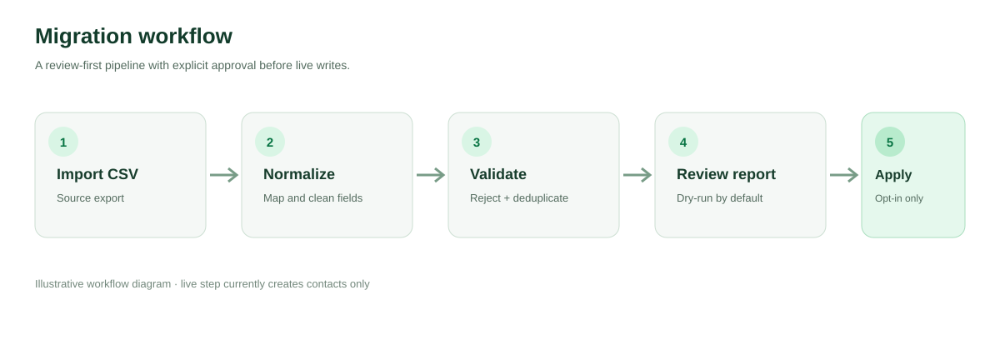

# HubSpot CRM Migration & Automation Toolkit

A Python reference implementation for CSV-based CRM contact cleanup, validation, duplicate detection, dry-run previews, and opt-in HubSpot contact creation.

> Scope: this starter currently creates contacts only. Companies, deals, notes, activities, associations, and upsert behavior are not yet implemented.

## UI and workflow previews

These are illustrative SVG previews using synthetic data, not screenshots from a connected HubSpot portal.

### Migration workbench


### Data quality review


### Workflow


## Features

- CSV ingestion and common CRM header mapping
- Email and phone normalization
- Basic email validation and local duplicate detection
- Streamlit preview dashboard and cleaned CSV download
- Dry-run CLI and JSON migration report
- Explicitly gated HubSpot CRM v3 contact batch creation
- Pytest suite and GitHub Actions CI for Python 3.11 and 3.12

## Quick start

Requires Python 3.11+.

```bash
git clone https://github.com/HardikPaghdar/hubspot-crm-migration-automation.git
cd hubspot-crm-migration-automation
python -m venv .venv
source .venv/bin/activate  # Windows: .venv\\Scripts\\activate
pip install -e ".[dashboard,dev]"
```

### Run a safe dry-run

```bash
python -m hubspot_migration.cli sample_data/contacts.csv --report reports/preview.json
```

The included synthetic dataset has 6 rows: 3 expected valid unique contacts, 1 duplicate, and 2 rejected rows. Verify results by running the code locally.

### Run the dashboard

```bash
streamlit run app.py
```

The dashboard only previews data and never writes to HubSpot.

### Configure an approved live pilot

Copy `.env.example` to `.env`, add a HubSpot private app token with only required scopes, and set:

```dotenv
HUBSPOT_ACCESS_TOKEN=your_private_app_token
HUBSPOT_API_BASE_URL=https://api.hubapi.com
HUBSPOT_CONFIRM_LIVE_MIGRATION=YES
```

After reviewing a dry-run and testing in a sandbox or small pilot:

```bash
python -m hubspot_migration.cli path/to/approved_contacts.csv --apply --report reports/live-run.json
```

Live writes require both `--apply` and `HUBSPOT_CONFIRM_LIVE_MIGRATION=YES`. This creates contacts only; it does not update existing records or check for duplicates already in HubSpot. Never commit `.env` or a real token.

## Tests

```bash
pytest -q
python -m compileall -q src app.py
```

## Repository layout

- `app.py` — Streamlit migration preview
- `src/hubspot_migration/` — CSV loader, normalization, validation, deduplication, API client, report, and CLI
- `sample_data/contacts.csv` — synthetic sample records
- `config/field_mapping.json` — example contact property mapping
- `tests/` — automated tests
- `docs/` — architecture, runbook, and illustrative previews
- `.github/workflows/ci.yml` — CI workflow
- `Dockerfile` — preview dashboard container

## Production hardening

Before production use, add remote duplicate checks and idempotency, update/upsert semantics, companies/deals/notes/activities and associations, persistent checkpoints, per-record outcomes, bounded retry/backoff, custom-property validation, sandbox integration tests, reconciliation and rollback procedures, and agreed data privacy/retention controls.

See [architecture](docs/architecture.md) and [migration runbook](docs/migration-runbook.md).

## License

No license has been added yet. Add one before external reuse or contributions.
